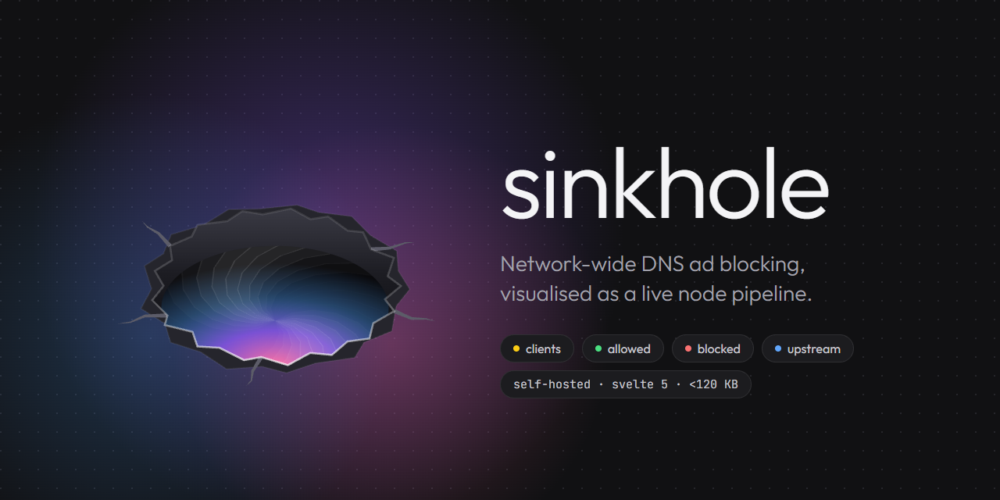
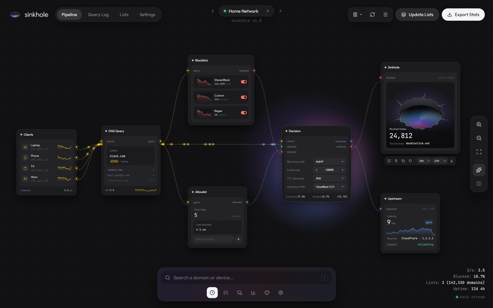
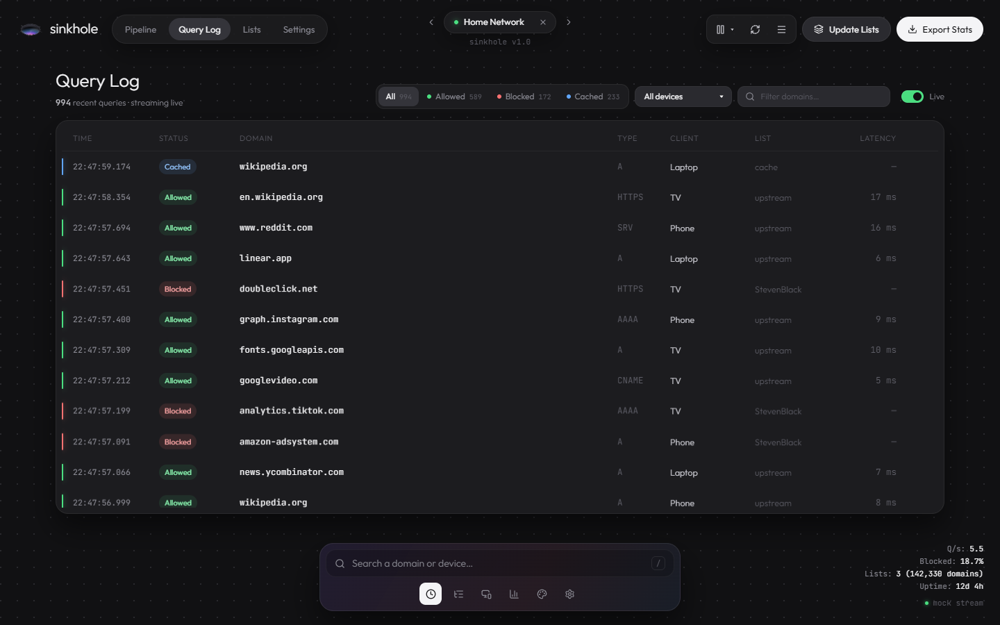
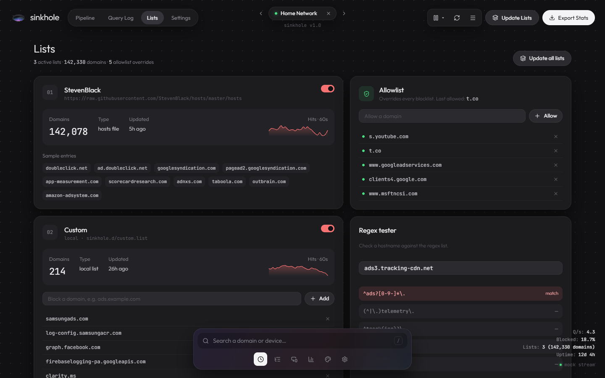
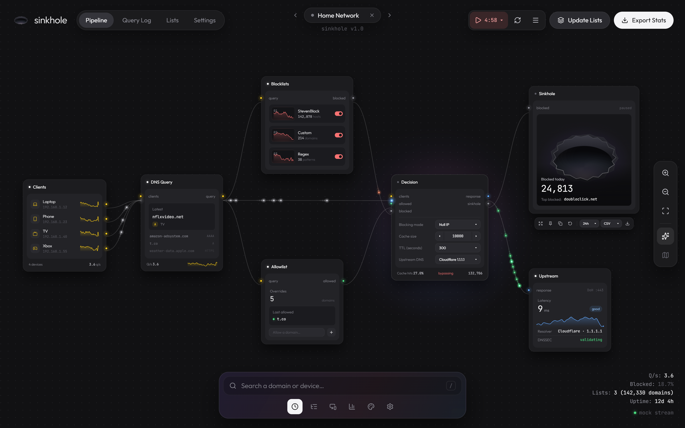
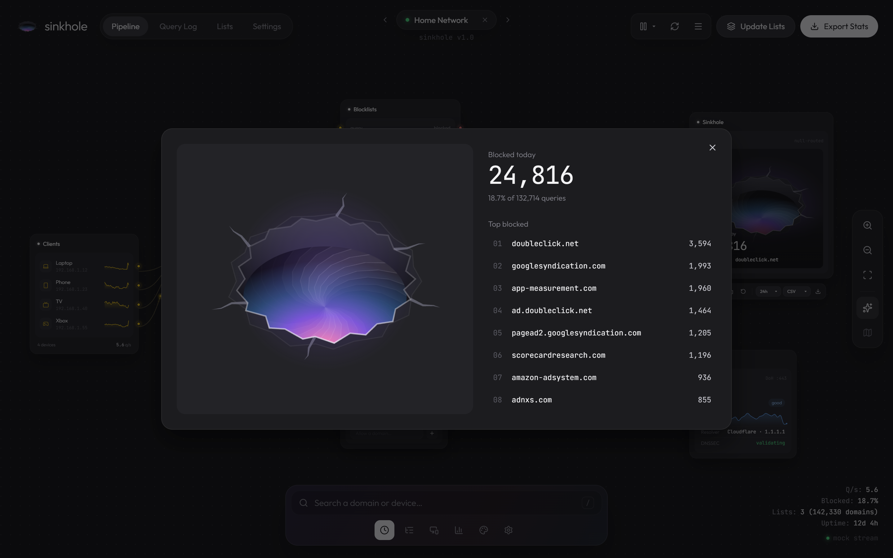
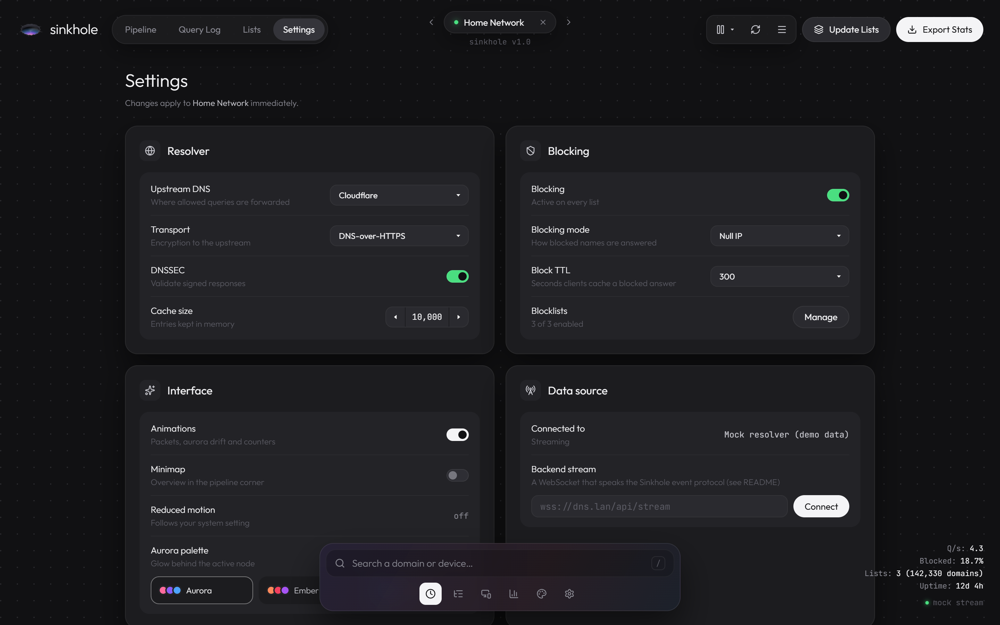

<p align="center">
  
</p>

<p align="center">
  <b>A self-hosted, network-wide DNS ad blocker dashboard — built as a live node pipeline.</b><br />
  Watch every query travel from device to decision, then spiral into the sinkhole.
</p>

<p align="center">
  <a href="https://highskai.github.io/sinkhole/"><b>▶ Try the live demo</b></a> — runs entirely in your browser on mock data
</p>

<p align="center">
  <a href="https://github.com/HighSkai/sinkhole/releases"></a>
  <a href="https://github.com/HighSkai/sinkhole/actions/workflows/ci.yml"></a>
  <a href="https://highskai.github.io/sinkhole/"></a>
  <a href="LICENSE"></a>
  
  
  
  
</p>

<p align="center">
  <a href="https://highskai.github.io/sinkhole/">Live demo</a> ·
  <a href="#features">Features</a> ·
  <a href="#quick-start">Quick start</a> ·
  <a href="#self-hosting">Self-hosting</a> ·
  <a href="#wiring-a-real-dns-backend">Real backend</a> ·
  <a href="#performance">Performance</a> ·
  <a href="#project-structure">Structure</a>
</p>

<br />

<p align="center">
  
</p>

## What is it?

**Sinkhole** is the dashboard for a Pi-hole-style DNS sinkhole, reimagined as a node graph — think ComfyUI or DaVinci Resolve's colour page, but for your home network's DNS. Every device on the left, every decision in the middle, and every blocked tracker falling into a glowing hole on the right.

It ships with a realistic **mock resolver** so it runs out of the box, behind a small, typed data layer that can be pointed at a real DNS backend over a single WebSocket.

## Features

- **Live node pipeline** — Clients → DNS Query → Blocklists / Allowlist → Decision → Sinkhole / Upstream, built on Svelte Flow. Drag nodes, pan, zoom, minimap, fit-view; your layout is remembered.
- **One-canvas packet animation** — every query is a glowing dot drawn on a single `<canvas>` (capped at 200, sampled under heavy traffic). Allowed queries turn green and leave via Upstream; blocked ones turn red at Decision, curve into the Sinkhole and spiral into the void.
- **A logo that reacts** — the hole pulses, ripples and its cracks flicker each time something falls in. A slow conic swirl turns inside (~20s per turn).
- **Pause blocking** for 30s / 5m / 1h / until re-enabled — cracks retract, the glow drains to grey, wires desaturate and packets pass straight through. Resuming splits the cracks back open.
- **Decision controls** — blocking mode (Null IP, NXDOMAIN, Refused, NODATA), cache size stepper, TTL, upstream resolver (Cloudflare, Quad9, Google, AdGuard, Unbound).
- **Query Log** — virtualised list of the last 10,000 queries; new rows slide in from the top with a coloured edge, blocked rows shake. Filter by status, device or domain, and allow/block straight from a row.
- **Lists** — StevenBlack, custom and regex lists with toggles, live hit sparklines, entry editors, an allowlist and a regex tester.
- **Command bar** — search domains and devices, quick stats, palette switcher (Aurora · Ember · Glacier) and quick settings. Press <kbd>/</kbd>.
- **Profiles** — switch between Home Network, Guest Wi-Fi and IoT VLAN from the breadcrumb.
- **Exports** — stats and blocked-domain exports as CSV or JSON, plus a copy-to-clipboard summary.
- **Calm by default** — odometer counters, drifting aurora glows and soft hover lifts; everything respects `prefers-reduced-motion`, pauses when the tab is hidden and can be switched off from the toolbar.

## Screenshots

<table>
  <tr>
    <td width="50%"><p align="center"><sub><b>Query Log</b> — virtualised, live, filterable</sub></p></td>
    <td width="50%"><p align="center"><sub><b>Lists</b> — blocklists, allowlist, regex tester</sub></p></td>
  </tr>
  <tr>
    <td width="50%"><p align="center"><sub><b>Paused</b> — cracks retract, the hole greys out, traffic bypasses</sub></p></td>
    <td width="50%"><p align="center"><sub><b>Expanded sinkhole</b> — top blocked domains</sub></p></td>
  </tr>
  <tr>
    <td colspan="2"><p align="center"><sub><b>Settings</b> — resolver, blocking, interface and data source</sub></p></td>
  </tr>
</table>

## Quick start

Requires **Node 20.19+** (or 22.12+).

```bash
git clone https://github.com/HighSkai/sinkhole.git
cd sinkhole
npm install
npm run dev          # http://localhost:5173 — runs against the mock resolver
```

| Script | What it does |
| --- | --- |
| `npm run dev` | Vite dev server with HMR |
| `npm run build` | Production build → `dist/` (minified, hashed, `.br` + `.gz` precompressed) |
| `npm run preview` | Serve the production build locally |
| `npm run build:pages` | Build for a `/sinkhole/` subpath (what the GitHub Pages demo uses) |
| `npm run check` | `svelte-check` (strict TypeScript + a11y) |
| `npm run size` | Report gzip/brotli JS for the first paint and the default route; fails over budget |

## Self-hosting

`npm run build` produces a fully static `dist/` folder. Every asset under `dist/assets/` is content-hashed (cache it forever) and ships with precompressed `.br` and `.gz` siblings.

**Docker (Caddy)** — the simplest route:

```bash
docker build -t sinkhole .
docker run -d -p 8080:80 --name sinkhole sinkhole
```

**Caddy** — [`deploy/Caddyfile`](deploy/Caddyfile) serves the precompressed files, sets immutable caching on hashed assets and falls back to `index.html`.

**nginx** — [`deploy/nginx.conf`](deploy/nginx.conf) does the same with `gzip_static` / `brotli_static` (the latter needs the `ngx_brotli` module).

Both configs include a commented `/api` block for proxying the WebSocket of a real backend on the same origin.

**Under a subpath** — build with `npx vite build --base /your/path/`. The [live demo](https://highskai.github.io/sinkhole/) is deployed this way by [`.github/workflows/pages.yml`](.github/workflows/pages.yml) on every push to `main`.

## Wiring a real DNS backend

All UI state flows through one interface, [`DnsSource`](src/lib/data/types.ts). The mock ([`mock.ts`](src/lib/data/mock.ts)) and the WebSocket adapter ([`ws.ts`](src/lib/data/ws.ts)) both implement it, and the store applies incoming events **once per animation frame**, so a burst of 500 queries costs one reactive update.

Point the UI at your backend with either:

- a build-time env var: `VITE_SINKHOLE_WS=wss://dns.lan/api/stream npm run build`, or
- at runtime: **Settings → Data source → Connect** (saved in the browser).

The adapter expects:

| Channel | Shape |
| --- | --- |
| `GET {base}/snapshot?profile=home` | a `Snapshot` — clients, lists, allowlist, config, today's counters, recent queries |
| `WS {base}/stream` → client | one `DnsEvent` (or an array of them) per message |
| client → `WS {base}/stream` | commands: `pause`, `resume`, `list`, `update-lists`, `entry-add`, `entry-remove`, `allow`, `unallow`, `config`, `reset-counter` |

```jsonc
// server → client
{ "t": "query", "q": { "id": 81234, "ts": 1764107520123, "domain": "doubleclick.net",
                       "client": "tv", "qtype": "A", "status": "blocked", "list": "stevenblack", "ms": 0 } }
{ "t": "blocking", "paused": true, "until": 1764107820000 }
{ "t": "lists", "lists": [ /* ListInfo[] */ ] }

// client → server
{ "op": "pause", "ms": 300000 }
{ "op": "config", "patch": { "upstream": "quad9", "ttl": 300 } }
```

`status` is one of `allowed`, `cached`, `blocked` or `allowlisted`; set `bypassed: true` on queries that would have been blocked while blocking is paused. The adapter reconnects with exponential backoff.

## Performance

| Budget | Target | Actual |
| --- | --- | --- |
| JS for first paint (shell) | < 120 KB gz | **50.0 KB** gz · 44.2 KB br |
| JS for the full default route (shell + Svelte Flow pipeline + data) | < 120 KB gz | **116.7 KB** gz · 102.0 KB br |
| Fonts | Latin subset, 2 weights per family | 4 × woff2, ~71 KB total, `font-display: swap` |

How it stays light:

- **Svelte 5** compiles away — no virtual DOM. Tailwind v4 emits only the classes used. No component, chart or animation libraries.
- **Code-split pages** (Pipeline, Query Log, Lists, Settings) load on demand; Svelte Flow lives only in the Pipeline chunk, which is `modulepreload`ed so it downloads in parallel while the shell paints. The minimap, command-bar panel and modals are split out too.
- **One canvas** for every packet, driven by a single `requestAnimationFrame` loop that sleeps when there is nothing to draw. Glows are pre-rendered sprites, not per-frame gradients.
- **Transforms and opacity only** for motion. The aurora blobs are pre-rendered radial-gradient layers with `will-change: transform`, never live blur filters.
- **Virtualised Query Log** — only the visible rows (plus overscan) exist in the DOM.
- **Everything pauses** when the tab is hidden or animations are toggled off.
- Charts and sparklines are hand-written SVG paths; icons are imported one by one from Lucide.

## Keyboard shortcuts

| Key | Action |
| --- | --- |
| <kbd>1</kbd> – <kbd>4</kbd> | Pipeline · Query Log · Lists · Settings |
| <kbd>/</kbd> | Focus the command bar |
| <kbd>P</kbd> | Pause / resume blocking |
| <kbd>A</kbd> | Toggle animations |
| <kbd>M</kbd> | Toggle minimap |
| <kbd>F</kbd> | Fit view |
| <kbd>+</kbd> / <kbd>−</kbd> | Zoom |
| <kbd>?</kbd> | Shortcut sheet |

## Project structure

```text
src/
├─ App.svelte                 shell, routing, shortcuts
├─ app.css                    tokens, fonts, shared surfaces
├─ lib/
│  ├─ data/                   types · store (frame-batched) · mock · ws · source picker
│  ├─ logo/                   deterministic geometry + animated <Logo>
│  ├─ shell/                  TopBar · RightToolbar · CommandBar · LiveStats · Overlays
│  ├─ state/                  UI state, lazy page loader
│  └─ ui/                     Odometer · Sparkline · Select · Stepper · Toggle · Popover
└─ pages/
   ├─ pipeline/               Svelte Flow canvas, nodes, wires, PacketLayer, Aurora
   ├─ log/                    virtualised Query Log
   ├─ lists/                  list management
   └─ settings/
deploy/                       Caddyfile · nginx.conf
scripts/                      size budget · screenshot capture · asset generator
docs/                         banner, logo, screenshots
```

## Roadmap

- [ ] Reference backend adapter (dnsmasq / Unbound log tailer → WebSocket)
- [ ] Per-client groups and schedules
- [ ] Historical charts (24h / 7d) from a persistent store
- [ ] Light theme

## Credits & license

Released under the [MIT License](LICENSE).

Bundled fonts: [Outfit](https://github.com/Outfitio/Outfit-Fonts) and [JetBrains Mono](https://github.com/JetBrains/JetBrainsMono), both under the SIL Open Font License 1.1 ([details](src/assets/fonts/LICENSE.md)). Icons by [Lucide](https://lucide.dev) (ISC). Node canvas by [Svelte Flow](https://svelteflow.dev) (MIT).

Sinkhole is an independent project inspired by the idea of network-wide DNS blocking; it is not affiliated with Pi-hole®.
